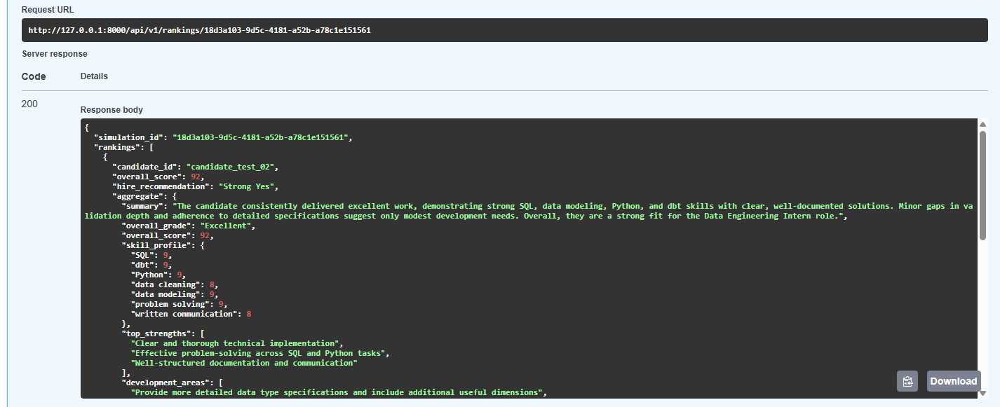
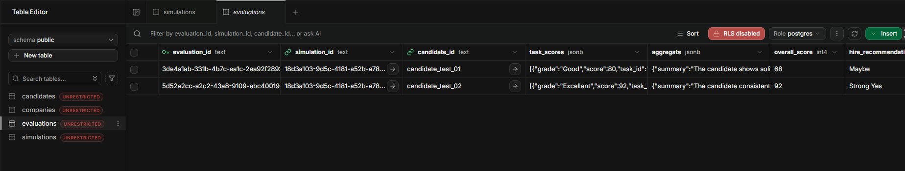
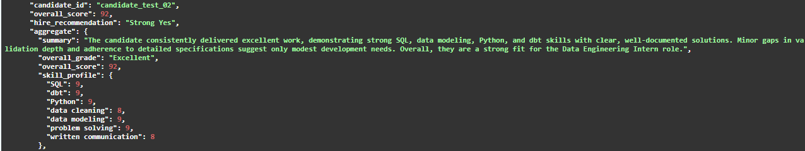

# AIntern — AI-Powered Internship Simulation & Candidate Evaluation

An AI-powered platform that generates company-specific internship simulations, evaluates candidate responses using large language models, and ranks candidates based on their performance.

**Project context:** Developed as part of my AI & Machine Learning internship at **Atomyum VB**, under mentor supervision.

> This repository is a portfolio presentation of my internship work. AIntern originated as an Atomyum VB project; it is not presented as a project created independently from scratch.

## Overview

AIntern helps organizations assess early-career candidates through realistic, role-specific tasks.

The system follows this workflow:

**Company Information → RAG Context → LLM → Internship Simulation → Candidate Responses → AI Evaluation → Supabase → Candidate Rankings**

### Key Features

- **AI-generated simulations:** Creates internship tasks based on company information, job descriptions, and desired skills.
- **Retrieval-Augmented Generation:** Uses ChromaDB to retrieve relevant company context.
- **LLM-based evaluation:** Assesses candidate responses against task-specific rubrics.
- **Structured feedback:** Produces scores, strengths, weaknesses, demonstrated skills, and hiring recommendations.
- **Database persistence:** Stores simulation and evaluation results in Supabase.
- **Candidate rankings:** Retrieves and ranks candidates by overall evaluation score.

## My Contributions

During my AI & Machine Learning internship, I worked on the following components:

### 1. LLM Integration and Prompt Engineering

- Experimented with Groq API and LangChain.
- Tested system prompts, user prompts, and temperature settings.
- Worked with structured JSON responses and output parsing.

### 2. Retrieval-Augmented Generation (RAG)

- Practiced document embeddings and semantic retrieval using ChromaDB.
- Tested retrieval behavior with different queries.
- Explored how retrieved company context can support LLM-generated responses.

### 3. FastAPI and Database Integration

- Worked with FastAPI endpoints for simulation generation and candidate evaluation.
- Tested API responses using Swagger UI.
- Verified simulation and evaluation persistence in Supabase.

### 4. Candidate Evaluation and Ranking

- Worked on an LLM-as-a-Judge evaluation pipeline using task-specific rubrics.
- Tested candidate scoring, structured feedback, and ranking functionality.
- Verified the end-to-end workflow from API responses to database records.

### 5. Database Integration Bug Fix

During evaluation testing, I identified a database foreign key constraint error that prevented evaluation results from being saved.

**Problem:** The evaluation referenced a candidate ID that did not exist in the Supabase `candidates` table.

**Solution:** Added a candidate upsert step before evaluation persistence.

**Result:**
- Evaluation requests returned HTTP 200.
- Candidate records were available before evaluation insertion.
- Evaluation results were successfully persisted.
- Stored evaluations appeared correctly in candidate rankings.

This demonstrated the importance of testing the complete application workflow, not just the LLM response.

## Tech Stack

| Category | Technologies |
|---|---|
| Programming Language | Python 3.11+ |
| Backend | FastAPI, Uvicorn |
| LLM Provider | Groq API |
| LLM Orchestration | LangChain |
| Retrieval / Vector Store | ChromaDB |
| Database | Supabase (PostgreSQL) |
| Data Validation | Pydantic |
| Development | Git, GitHub, Jupyter Notebook |
| Testing | Swagger UI, API and database integration testing |

The application configuration currently defaults to `openai/gpt-oss-120b` through Groq. The model can be changed using the `GROQ_MODEL` environment variable.

## API Endpoints

The application includes three main endpoints:

| Method | Endpoint | Description |
|---|---|---|
| POST | `/api/v1/generate` | Generate a company-specific internship simulation |
| POST | `/api/v1/evaluate` | Evaluate candidate responses |
| GET | `/api/v1/rankings/{simulation_id}` | Retrieve candidate rankings |

## Testing and Results

The evaluation and ranking workflow was tested with two candidates responding to the same simulation.

| Test Candidate | Overall Score | Grade | Hiring Recommendation |
|---|---:|---|---|
| candidate_test_02 | 92 | Excellent | Strong Yes |
| candidate_test_01 | 68 | Adequate | Maybe |

The ranking endpoint correctly ordered candidates by overall score and returned a total of two candidates.

These are **development test results**, not a benchmark of evaluation accuracy or real-world hiring effectiveness.

### Test Evidence

**Evaluation API response**



**Supabase persistence**



**Candidate rankings**



Additional evidence is available in [`docs/week5/`](docs/week5/).

## Project Structure

```text
app/
  api/routes/
    evaluation.py
    simulation.py
  core/
    llm.py
    prompts.py
    vector_store.py
  schemas/
  services/
    candidate_evaluator.py
    simulation_generator.py
    supabase_client.py
  config.py
  main.py

docs/
  final-report/
  week5/
  schema.sql

notebooks/
  01_llm_basics.ipynb
  02_rag_demo.ipynb

requirements.txt
.env.example
README.md
```

## Getting Started

### Prerequisites

- Python 3.11+
- A Groq API key
- Supabase project credentials for database-backed features

### 1. Clone the repository

```bash
git clone https://github.com/mustafacelik-86/aintern-ai-internship-platform.git
cd aintern-ai-internship-platform
```

### 2. Create a virtual environment

**Windows PowerShell:**

```powershell
python -m venv venv
.\venv\Scripts\Activate.ps1
```

### 3. Install dependencies

```bash
pip install -r requirements.txt
```

### 4. Configure environment variables

Copy `.env.example` to `.env` and edit the values.

```powershell
Copy-Item .env.example .env
```

Configure the following variables:

```dotenv
GROQ_API_KEY=your_groq_api_key_here
GROQ_MODEL=openai/gpt-oss-120b

SUPABASE_URL=your_supabase_project_url
SUPABASE_ANON_KEY=your_supabase_anon_key

APP_ENV=development
LOG_LEVEL=INFO
```

Never commit your actual `.env` file or API credentials.

### 5. Start the API

```bash
uvicorn app.main:app --reload
```

Open the interactive API documentation at:

`http://127.0.0.1:8000/docs`

Database-backed functionality requires an appropriately configured Supabase database. See [`docs/schema.sql`](docs/schema.sql) for the project schema.

## Documentation

- [Final Project Report](docs/final-report/README.md)
- [Week 5 Evaluation Evidence](docs/week5/README.md)
- [Database Schema](docs/schema.sql)

## Project Attribution and Usage

AIntern was developed within the **Atomyum VB internship program** under mentor supervision.

This repository showcases my learning, implementation work, testing, and contributions during the internship.

The original project is not claimed as my independent creation. The portfolio version is shared with mentor permission.

**License:** No open-source license is granted by this repository. Public visibility does not imply permission to reuse, modify, or redistribute the project.
